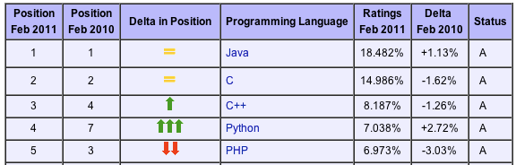
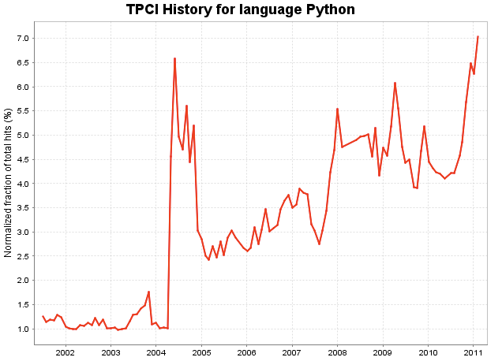

Python - самый популярный язык программирования после Java, C, C++ (именно в таком порядке).

Источник - [http://www.tiobe.com/index.php/content/paperinfo/tpci/index.html](http://www.tiobe.com/index.php/content/paperinfo/tpci/index.html)