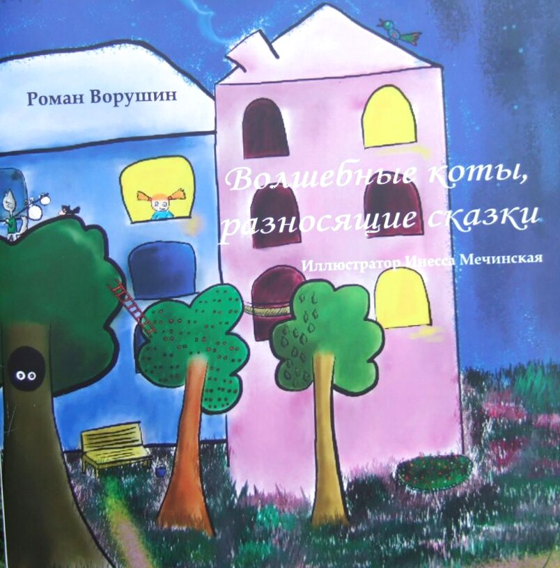

# Magic Cats Storybook Page Implementation Plan

> **For agentic workers:** REQUIRED SUB-SKILL: Use superpowers:subagent-driven-development (recommended) or superpowers:executing-plans to implement this plan task-by-task. Steps use checkbox (`- [ ]`) syntax for tracking.

**Goal:** Ship `/books/magic-cats` — a single-page, trilingual (EN/DE/RU) scroll storybook of «Волшебные коты, разносящие сказки» on vorushin.github.io.

**Architecture:** One Jekyll page (`books/magic-cats.html`, minimal standalone layout `_layouts/book.html`) renders all three languages from `_data/magic_cats.yml`; a `data-lang` attribute on `<html>` + CSS hides inactive languages; ~70 lines of vanilla JS handle language detection/switching, scene background shifts, and fade-ins. Processed illustrations live in `img/magic-cats/` with stable filenames (Phase-2 AI art is a drop-in file replacement).

**Tech Stack:** Jekyll 4.3 (existing site), Liquid, vanilla JS, CSS. ImageMagick (`magick`, available at /opt/homebrew/bin) for photo crops. No new dependencies.

## Global Constraints

- URL must be exactly `/books/magic-cats` (permalink).
- Page must be fully readable without JS, in English (static default `data-lang="en"` on `<html>`).
- All animation/transitions guarded by `prefers-reduced-motion: reduce`.
- Reading column ~40rem (≈640px), works on phone portrait and landscape.
- Canonical Russian text: `book_cats/text_russian.md` (NOT the inline-pictures variant — it has the typo «на площадки»).
- Image filenames in `img/magic-cats/` are a stable contract: `cover.jpg`, `candle.png`, `summer-tree.png`, `moon-milk.jpg`, `tree-library.png`, `lavender-calf.png`, `night-garden.png`, `angel.png`, `printed-books.jpg`, `printed-spread.jpg`.
- Nothing is pushed to origin (push = deploy); commits stay local until Roman approves.
- Commit trailer on every commit:
  `Co-Authored-By: Claude Fable 5 <noreply@anthropic.com>` and
  `Claude-Session: https://claude.ai/code/session_01Ta555igjGtpd33W2wjZUv3`

---

### Task 1: Housekeeping — keep sources out of git and out of the built site

**Files:**
- Modify: `.gitignore`
- Modify: `_config.yml`

**Interfaces:**
- Produces: `book_cats/` ignored by git; `book_cats/`, `docs/`, `CLAUDE.md` excluded from Jekyll output. Later tasks rely on `bundle exec jekyll build` not copying these into `_site/`.

- [x] **Step 1: Append to `.gitignore`** (final content):

```
Gemfile.lock
_site/
.DS_Store
book_cats/
```

- [x] **Step 2: Add `exclude` list to `_config.yml`** (append at end of file):

```yaml
exclude:
  - book_cats
  - docs
  - CLAUDE.md
```

- [x] **Step 3: Verify build excludes them**

Run: `bundle exec jekyll build && ls _site/ | grep -E 'book_cats|docs|CLAUDE' ; echo "exit=$?"`
Expected: no matches, `exit=1` (grep found nothing). Build succeeds.

- [x] **Step 4: Verify git ignores book_cats**

Run: `git status --short | grep book_cats ; echo "exit=$?"`
Expected: no output, `exit=1`.

- [x] **Step 5: Commit**

```bash
git add .gitignore _config.yml
git commit -m "Exclude book sources and docs from git/site build"
```

---

### Task 2: Image pipeline — `img/magic-cats/`

**Files:**
- Create: `img/magic-cats/` (10 images)

**Interfaces:**
- Consumes: `book_cats/extracted/image1..6.png` (already extracted from the inline-pictures markdown), `book_cats/photos/DSCF2402.JPG` (two printed books), `DSCF2404.JPG` (front cover on grass), `DSCF2410.JPG` (moon-milk open spread), `DSCF2414.JPG` (back cover: moonbeam house).
- Produces: the 10 contract filenames above. Also produces measured px dimensions for `cover.jpg` and `moon-milk.jpg` used in Task 3's YAML (`image_w`/`image_h`).

- [x] **Step 1: Copy the six PNGs under contract names**

```bash
cd /Users/vorushin/Projects/vorushin.github.io
mkdir -p img/magic-cats
cp book_cats/extracted/image1.png img/magic-cats/candle.png
cp book_cats/extracted/image2.png img/magic-cats/summer-tree.png
cp book_cats/extracted/image3.png img/magic-cats/tree-library.png
cp book_cats/extracted/image4.png img/magic-cats/lavender-calf.png
cp book_cats/extracted/image5.png img/magic-cats/night-garden.png
cp book_cats/extracted/image6.png img/magic-cats/angel.png
```

- [x] **Step 2: Crop the front cover from DSCF2404 (iterate visually)**

Starting command (tune `-rotate` and `-crop` by viewing the result with the Read tool and adjusting until the book face fills the frame with no grass edges):

```bash
magick book_cats/photos/DSCF2404.JPG -rotate -1.5 -crop 880x860+365+150 +repage \
  -modulate 104,112 -quality 85 img/magic-cats/cover.jpg
```

Expected: `cover.jpg` shows the full front cover (night city, pink house, title lettering), edges straight, no grass visible. Iterate until true.

- [x] **Step 3: Crop the moon-milk art from DSCF2414 (iterate visually)**

```bash
magick book_cats/photos/DSCF2414.JPG -rotate -1 -crop 820x830+440+160 +repage \
  -modulate 104,112 -quality 85 img/magic-cats/moon-milk.jpg
```

Expected: `moon-milk.jpg` shows the moonbeam pouring into the little house's window, apple tree at right, no grass. Iterate until true.

- [x] **Step 4: Downscale the two afterword photos**

```bash
magick book_cats/photos/DSCF2402.JPG -resize 1200x -quality 82 img/magic-cats/printed-books.jpg
magick book_cats/photos/DSCF2410.JPG -resize 1200x -quality 82 img/magic-cats/printed-spread.jpg
```

- [x] **Step 5: Measure final dimensions (needed for Task 3 YAML)**

Run: `sips -g pixelWidth -g pixelHeight img/magic-cats/*.jpg img/magic-cats/*.png`
Expected known PNG dims: candle 450×545, summer-tree 536×536, tree-library 500×500, lavender-calf 620×602, night-garden 560×560, angel 550×550; afterword photos 1200×900. Record cover.jpg and moon-milk.jpg dims for Task 3.

- [x] **Step 6: Visual check of all 10 with the Read tool** — each image correct content, orientation, colors.

- [x] **Step 7: Commit**

```bash
git add img/magic-cats
git commit -m "Add processed illustrations for magic cats storybook"
```

---

### Task 3: Content — `_data/magic_cats.yml`

**Files:**
- Create: `_data/magic_cats.yml`

**Interfaces:**
- Consumes: cover/moon-milk dims from Task 2.
- Produces: `site.data.magic_cats` with keys `langs` (array), `meta.title.{en,de,ru}`, `meta.byline.{...}`, `meta.cover_alt.{...}`, `sections[]` (`id`, `image`, `image_w`, `image_h`, `scene`, `alt.{...}`, `paragraphs[].{en,de,ru}`), `afterword` (`heading.{...}`, `paragraphs[].{...}`, `photos[].{file,w,h,alt.{...}}`). Task 5's Liquid iterates exactly these keys.

- [x] **Step 1: Write the file.** Complete content (cover/moon-milk `image_w/h` from Task 2 measurements — values below assume 880×860 and 820×830; replace with measured):

```yaml
langs: [en, de, ru]

meta:
  title:
    en: "The Magical Cats Who Deliver Fairy Tales"
    de: "Die Zauberkatzen, die Märchen bringen"
    ru: "Волшебные коты, разносящие сказки"
  byline:
    en: "written by Roman Vorushin · illustrated by Inessa Mechinskaya"
    de: "geschrieben von Roman Vorushin · illustriert von Inessa Mechinskaya"
    ru: "текст — Роман Ворушин · иллюстрации — Инесса Мечинская"
  cover_alt:
    en: "Book cover: a night city with a pink house, glowing windows and trees"
    de: "Buchumschlag: eine nächtliche Stadt mit einem rosa Haus, leuchtenden Fenstern und Bäumen"
    ru: "Обложка книги: ночной город, розовый дом со светящимися окнами и деревья"
  cover_w: 880
  cover_h: 860

sections:
  - id: candle
    image: candle.png
    image_w: 450
    image_h: 545
    scene: night
    alt:
      en: "A candle glowing on a windowsill against the starry night"
      de: "Eine Kerze leuchtet auf dem Fensterbrett vor dem Sternenhimmel"
      ru: "Свеча на подоконнике на фоне звёздной ночи"
    paragraphs:
      - en: >-
          In one city, the evening tales are delivered by magical cats. There, just like here,
          little ones are tucked into bed by papas and mamas, grandmas and grandpas, or big
          brothers and sisters. While the children are still small, everyone sings them songs
          and tells them the tales they once read themselves. But as the children grow, the
          remembered tales run out — and new ones have to come from somewhere, because little
          ones so love a bedtime story! Here, we usually lie down very, very quietly, close our
          eyes and wait for a story to come to Papa. But in that city, the stories are brought
          by cats.
        de: >-
          In einer Stadt werden die Abendmärchen von Zauberkatzen ausgetragen. Dort werden die
          Kleinen genau wie bei uns von Papa oder Mama, Oma oder Opa oder den großen
          Geschwistern ins Bett gebracht. Solange die Kinder noch klein sind, singt man ihnen
          Lieder vor und erzählt Märchen, die man selbst einmal gelesen hat. Doch wenn die
          Kinder größer werden, gehen die gelesenen Märchen irgendwann aus — und neue müssen
          irgendwoher kommen, denn die Kleinen hören vor dem Einschlafen doch so gern
          Geschichten! Wir legen uns meist ganz, ganz leise hin, schließen die Augen und warten,
          bis eine Geschichte zu Papa kommt. In dieser Stadt aber bringen die Katzen die Märchen.
        ru: >-
          В одном городе вечерние сказки разносят волшебные коты. Там также, как и у нас,
          малышей укладывают спать папы или мамы, бабушки или дедушки, или старшие
          братья-сестры. Когда детки еще маленькие, им поют песенки и рассказывают сказки,
          которые когда-то прочитали. Но когда детки подрастают, то прочитанные сказочки уже
          заканчиваются и нужно их откуда-то брать, ведь малыши так любят слушать сказки перед
          сном! Мы обычно ложимся тихо-тихо, закрываем глазки и ждем, когда сказка придет к
          папе. А в этом городе сказки разносят коты.

  - id: summer-tree
    image: summer-tree.png
    image_w: 536
    image_h: 536
    scene: day-yellow
    alt:
      en: "A sunny tree by a house, a grey cat sitting above the window"
      de: "Ein sonniger Baum an einem Haus, über dem Fenster sitzt eine graue Katze"
      ru: "Солнечное дерево у дома, над окном сидит серый кот"
    paragraphs:
      - en: >-
          Nobody knows where the cats live. People have only noticed that they walk along the
          treetops. That is why the city is full of trees. Before anyone builds a house, they
          first grow trees around it, making sure they link up with the other chains of trees.
          After all, nobody wants to live in a house without fairy tales.
        de: >-
          Niemand weiß, wo die Katzen wohnen. Man hat nur bemerkt, dass sie über die Baumwipfel
          laufen. Deshalb gibt es in dieser Stadt sehr viele Bäume. Bevor man irgendwo ein Haus
          baut, pflanzt man dort zuerst Bäume und achtet darauf, dass sie sich mit den anderen
          Baumketten verbinden. Denn niemand will in einem Haus ohne Märchen wohnen.
        ru: >-
          Никто не знает, где они живут. Заметили только, что коты ходят по вершинам деревьев.
          Поэтому в этом городе очень много деревьев. Прежде чем строить где-то дом, там сначала
          растят деревья, стараясь чтобы они соединились с другими цепочками деревьев. Ведь
          никто не хочет жить в доме без сказок.
      - en: >-
          The cats carry the tales in their teeth, each one wrapped in a little white sheet.
          Kittens help too: when they are old enough, they first walk beside their papa-cat or
          mama-cat — learning the way, learning how to slip in through a window. Then they begin
          to help carry. Papa carries two big tales, while the kitten puffs along with one tiny
          tale in its teeth. Later it carries a bigger tale, then two at once — and one day it
          delivers the tales all on its own.
        de: >-
          Die Katzen tragen die Märchen im Maul, jedes in ein kleines weißes Laken gewickelt.
          Die Kätzchen helfen mit: Wenn sie groß genug sind, laufen sie zuerst neben Katzenpapa
          oder Katzenmama her — sie merken sich den Weg und lernen, durchs Fenster
          hereinzukommen. Dann helfen sie beim Tragen. Papa trägt zwei große Märchen, und das
          Kätzchen schnauft und müht sich mit einem winzigen Märchen im Maul. Später trägt es
          ein größeres Märchen, dann gleich zwei — und eines Tages trägt es die Märchen ganz
          allein aus.
        ru: >-
          Коты носят сказки в зубах. Сказки завернуты в маленькие белые простынки. Котам
          помогают котята - когда они подрастают, то сначала ходят с папой-котом или
          мамой-кошкой рядышком - запоминают дорогу, учатся заходить в окно. Потом уже помогают
          таскать сказки. Папа несет две большие сказки, а котенок пыхтит-старается с маленькой
          сказочкой в зубах. Потом уже таскает сказку побольше, потом целых две, а потом уже
          разносит сказочки без папы.

  - id: moon-milk
    image: moon-milk.jpg
    image_w: 820
    image_h: 830
    scene: night
    alt:
      en: "A moonbeam pours through the window of a little house"
      de: "Ein Mondstrahl fällt durch das Fenster eines Häuschens"
      ru: "Лунный луч льётся в окно домика"
    paragraphs:
      - en: >-
          Everyone is glad to see the cats, and everyone puts out treats. These magical cats
          don't eat mice or little birds — for them, people gather moon milk. On nights of the
          full moon, when the moon shines its very brightest, people set out white saucers under
          the moonlight. The moon pours its light into them, and early in the morning, before
          the sun rises, the saucers are brought in and kept in a dark room. In the evening,
          just before bed, you put the saucer of moon milk on the windowsill. Then the cat, once
          it has handed over its little bundle with a tale, pads over to the saucer and drinks.
          When a cat comes with its kitten, the kitten usually gets to the milk first — and papa
          or mama laps up whatever is left.
        de: >-
          Über die Katzen freut man sich sehr und bewirtet sie. Diese Zauberkatzen fressen keine
          Mäuse und keine Vögelchen — für sie sammelt man Mondmilch. Bei Vollmond, wenn der Mond
          ganz hell scheint, stellen die Leute weiße Untertassen ins Mondlicht. Der Mond gießt
          sein Licht hinein, und früh am Morgen, noch vor Sonnenaufgang, holt man die Tellerchen
          herein und stellt sie in ein dunkles Zimmer. Am Abend, kurz vor dem Schlafengehen,
          stellt man die Untertasse mit der Mondmilch aufs Fensterbrett. Wenn die Katze dann ihr
          Bündelchen mit dem Märchen abgegeben hat, geht sie zur Untertasse und trinkt die
          Mondmilch. Kommt eine Katze mit ihrem Kätzchen, trinkt das Kätzchen meist zuerst — und
          Papa oder Mama schlecken auf, was übrig bleibt.
        ru: >-
          Котам очень рады и их угощают. Эти волшебные коты не едят мышек или птичек. Специально
          для них собирают лунное молоко. В полнолуние, когда луна светит ярко-ярко, люди
          выносят белые блюдечки и ставят под лунный свет. Луна льет туда свой свет, а рано
          утром, еще до восхода солнца, тарелочки нужно забрать и поставить в темную комнату. А
          вечером, перед тем как лечь в постель, блюдечко с лунным молоком нужно поставить на
          подоконник. Тогда кот, после того как отдаст узелок со сказкой, подойдет к блюдечку и
          будет пить лунное молоко. Обычно, когда кот ходит вместе с котенком, то котенок
          успевает попить молочко раньше, а уж папа или мама доедают то, что остается.

  - id: tree-library
    image: tree-library.png
    image_w: 500
    image_h: 500
    scene: day-green
    alt:
      en: "Two big trees with a hammock, a reading boy and bags of books hanging from the branches"
      de: "Zwei große Bäume mit Hängematte, einem lesenden Jungen und Büchertaschen an den Ästen"
      ru: "Два больших дерева: гамак, читающий мальчик и сумки с книгами на ветках"
    paragraphs:
      - en: >-
          In that city, people dearly love their trees. On the main tree streets the old trees
          have grown enormously tall and wide. People love to hang hammocks there and doze
          sweetly in them, and in some trees they set up little libraries — bags of books hung
          from the branches, just right for reading once you have climbed up. All kinds of
          beautiful birds live in the trees, and since the magical cats never hunt them, they
          live very happily. They love to flutter down to the people reading in the branches,
          who feed them biscuits and bread.
        de: >-
          In dieser Stadt liebt man die Bäume sehr. In den großen Baumstraßen sind die alten
          Bäume mit den Jahren riesig hoch und mächtig breit geworden. Man hängt dort gern
          Hängematten auf und schläft süß darin, und in manchen Bäumen sind kleine Bibliotheken
          eingerichtet — Taschen voller Bücher hängen an den Ästen, gerade recht zum Lesen, wenn
          man hinaufgeklettert ist. In den Bäumen wohnen allerlei schöne Vögel. Weil die
          Zauberkatzen nicht auf sie jagen, geht es ihnen prächtig. Sie fliegen gern zu den
          Menschen hinüber, die in den Bäumen lesen, und die füttern sie mit Keksen und Brot.
        ru: >-
          В этом городе очень любят деревья. А поскольку на главных деревьевых улицах старым
          деревьям много лет, то они успели вырости высоченными и широченными. На них любят
          вешать гамаки и сладко там спать, а на некоторых деревьях устраивают библиотеки -
          развешивают сумки с книгами, которые удобно читать, забравшись на ветку. На деревьях
          живут разные красивые птицы. Поскольку волшебные коты на них не охотятся, им очень
          хорошо живется. Они любят подлетать к людям, читающим на деревьях, и те кормят их
          печеньем или хлебом.

  - id: lavender-calf
    image: lavender-calf.png
    image_w: 620
    image_h: 602
    scene: dusk
    alt:
      en: "A white calf standing in tall lavender grass under the stars"
      de: "Ein weißes Kälbchen im hohen lavendelfarbenen Gras unter Sternen"
      ru: "Белый телёнок в высокой сиреневой траве под звёздами"
    paragraphs:
      - en: >-
          And when the children grow up, the magical cats bring the tales straight to them. So
          the children learn to read the tales and tell them on their own. And they learn to
          make up their own — or rather, they learn to see them, to notice them. For the magical
          worlds of fairy tales are always all around us; you only need to learn to notice them.
          And whoever discovers those worlds begins to dream of them. A child falls asleep, and
          the tale comes into their dream — or really, the child steps right into the tale. It
          is so wonderful that many children come to love sleeping very much. Daytime is lovely,
          of course — you can be with Papa and Mama, learn new things, and play with your
          brothers and sisters and the other kids on the playground. But at night you can step
          into a whole new magical fairy-tale world!
        de: >-
          Und wenn die Kinder größer werden, bringen die Zauberkatzen die Märchen ihnen selbst.
          So lernen die Kinder, die Märchen selbst zu lesen und zu erzählen. Und sie lernen,
          sich eigene auszudenken. Genauer gesagt: Sie lernen, sie zu sehen, sie zu bemerken.
          Denn die zauberhaften Märchenwelten sind immer um uns herum — man muss nur lernen, sie
          zu bemerken. Und wer diese Welten entdeckt, dem erscheinen sie im Traum. Das Kind
          schläft ein, und das Märchen kommt zu ihm in den Traum — eigentlich gerät das Kind
          selbst mitten ins Märchen hinein. Und das ist so wunderbar, dass viele das Schlafen
          richtig lieb gewinnen. Der Tag ist natürlich herrlich — man kann mit Papa und Mama
          zusammen sein, Neues entdecken und mit den Geschwistern und den anderen Kindern auf
          dem Spielplatz toben. Aber nachts — nachts kann man in eine ganz neue zauberhafte
          Märchenwelt geraten!
        ru: >-
          А когда дети подрастают, то волшебные коты приносят сказки им самим. И малыши учатся
          читать и рассказывать сказки сами. И учатся их придумывать. Точнее даже, учатся их
          видеть, замечать. Ведь волшебные миры сказок всегда вокруг нас, нужно только
          научиться их замечать. И те, кто открывает эти миры, тому они начинают сниться. Малыш
          засыпает, а сказка приходит к нему во сне, точнее он сам попадает в сказку. И это так
          замечательно, что многие начинают очень любить спать. Днем конечно очень здорово -
          можно дружить с папой и мамой, изучать что-то новое, играть с братиками-сестричками и
          другими детками на площадке. Но ведь ночью можно попасть в совершенно новый волшебный
          сказочный мир!

  - id: night-garden
    image: night-garden.png
    image_w: 560
    image_h: 560
    scene: night
    alt:
      en: "A starry night over a garden, a cat asleep in the grass, chalk-drawn clouds in the sky"
      de: "Sternennacht über einem Garten, eine Katze schläft im Gras, Kreidewolken am Himmel"
      ru: "Звёздная ночь над садом, в траве спит кот, в небе — нарисованные мелом облака"
    paragraphs:
      - en: >-
          You might dream of a world covered entirely by water, where people live in tall,
          round towers. Tall — because the towers must be dug deep into the ground under the
          water, so the waves can't sweep them away. Round — so the wind can't knock them over.
          Ropes are stretched between the towers, and you can ride from tower to tower: in one
          tower the rope is fastened higher, in the other lower, so you glide along nice and
          fast. Everyone has a special belt you lay over the rope to go rolling off. That is how
          people visit their friends, get to school, or simply go out for a ride.
        de: >-
          Vielleicht träumt man von einer Welt, die ganz von Wasser bedeckt ist und in der die
          Menschen in riesig hohen, runden Türmen wohnen. Hoch — weil man die Türme tief unter
          dem Wasser im Boden vergraben muss, damit die Wellen sie nicht fortreißen. Rund —
          damit der Wind sie nicht umwirft. Zwischen den Türmen sind Seile gespannt, an denen
          man von Turm zu Turm fahren kann. In dem einen Turm ist das Seil höher befestigt, im
          anderen tiefer, und darum saust man schön schnell hinüber. Jeder hat einen besonderen
          Gurt, den man übers Seil legt und losrollt. So besucht man Freunde, fährt zur Schule
          oder einfach spazieren.
        ru: >-
          Может присниться мир, в котором все покрыто водой, а люди живут в высоченных круглых
          башнях. Высоченных - потому что их нужно глубоко закапывать в землю под водой, чтобы
          их не сносило волнами. Круглых - чтобы их не валил ветер. А между башнями натянуты
          веревки, по которым можно переезжать с башни на башню. В одной башне веревка
          закреплена выше, а в другой - ниже, и поэтому по ней можно быстро ехать. У каждого
          есть специальный ремень, который можно положить на веревку и катиться. Так ходят в
          гости, в школу и просто гуляют.
      - en: >-
          And someone might dream of a world where people live on the clouds. Life there is
          never boring — you always have to move somewhere new when your cloud rains itself out.
          That is why everyone loves the neighborhoods with the sea and the mountains, where the
          clouds wander back and forth all day: in the morning from the sea to the shore, in the
          evening from the shore back out to sea. And the views there are wonderful!
        de: >-
          Und mancher träumt von einer Welt, in der die Menschen auf Wolken wohnen. Langweilig
          ist das Leben dort nie: Man muss immer wieder umziehen, wenn sich die eigene Wolke
          abgeregnet hat. Darum liebt man dort die Gegenden mit Meer und Bergen, wo die Wolken
          den ganzen Tag hin und her wandern — morgens vom Meer ans Ufer und abends vom Ufer
          aufs Meer hinaus. Und die Aussicht dort ist herrlich!
        ru: >-
          А кому-то снится мир, где люди живут на облаках. Это нескучная жизнь, нужно постоянно
          куда-то переезжать, когда облака выливаются дождем. Поэтому там любят районы, где
          есть море и горы, ведь там облака постоянно гуляют туда-сюда: утром с моря на берег, а
          вечером с берега на море. Да и виды там прекрасные!

  - id: angel
    image: angel.png
    image_w: 550
    image_h: 550
    scene: pale
    alt:
      en: "An angel with cloud-blue hair, eyes closed, a little bird beside them"
      de: "Ein Engel mit wolkenblauem Haar, die Augen geschlossen, daneben ein Vögelchen"
      ru: "Ангел с облачно-голубыми волосами и птичка рядом"
    paragraphs:
      - en: >-
          And I have also heard that some children dream of the world of the magical cats
          themselves. There the cats walk on their hind legs, live in little houses, and know
          how to talk. And they have a library — no, not really a library, a magical garden of
          fairy tales. Tales grow there on magical trees. Some tales grow for hundreds of years
          and are picked only on the most special occasions; others are picked the moment they
          ripen. Gardener cats walk the garden tending the trees — and the most experienced of
          them can even dream up entirely new ones.
        de: >-
          Und ich habe auch gehört, dass manche Kinder von der Welt der Zauberkatzen selbst
          träumen. Dort gehen die Katzen auf den Hinterbeinen, wohnen in kleinen Häusern und
          können sprechen. Und sie haben eine Bibliothek — nein, eigentlich keine Bibliothek,
          sondern einen zauberhaften Märchengarten. Dort wachsen die Märchen auf Zauberbäumen.
          Manche Märchen wachsen Hunderte von Jahren und werden nur zu ganz besonderen Anlässen
          gepflückt; andere pflückt man, sobald sie reif sind. Katzengärtner gehen dort umher
          und pflegen die Bäume — und die erfahrensten können sich sogar ganz neue Bäume
          ausdenken.
        ru: >-
          А еще я слышал, что некоторым деткам снится мир волшебных котов. Они там ходят на
          задних лапах, живут в домиках и умеют разговаривать. А еще у них есть библиотека,
          вернее даже не библиотека, а волшебный сад сказок. Там на волшебных деревьях растут
          сказки. Некоторые сказки растут сотни лет и их срывают в самых особенных случаях, а
          некоторые срывают как только они поспеют. Там ходят коты-садовники, которые ухаживают
          за деревьями, а самые опытные могут даже придумывать новые деревья.

afterword:
  heading:
    en: "About this book"
    de: "Über dieses Buch"
    ru: "Об этой книжке"
  paragraphs:
    - en: >-
        I wrote this story in 2012 as a bedtime tale for our family. My wife asked our friend
        Inessa Mechinskaya to illustrate it, and together they printed a tiny edition — some ten
        or twenty copies — for family and friends. Many years later, the little book found its
        way onto this page, so the magical cats could carry it a little further.
      de: >-
        Diese Geschichte habe ich 2012 als Gutenachtgeschichte für unsere Familie geschrieben.
        Meine Frau bat unsere Freundin Inessa Mechinskaya, sie zu illustrieren, und zusammen
        druckten sie eine winzige Auflage — etwa zehn bis zwanzig Exemplare — für Familie und
        Freunde. Viele Jahre später hat das Büchlein seinen Weg auf diese Seite gefunden, damit
        die Zauberkatzen es noch ein Stückchen weitertragen können.
      ru: >-
        Эту историю я написал в 2012 году — как вечернюю сказку для нашей семьи. Моя жена
        попросила нашу подругу Инессу Мечинскую нарисовать иллюстрации, и вместе они напечатали
        крошечный тираж — экземпляров десять-двадцать — для родных и друзей. Много лет спустя
        книжка добралась и до этой страницы — чтобы волшебные коты разнесли её немного дальше.
  photos:
    - file: printed-books.jpg
      w: 1200
      h: 900
      alt:
        en: "Two printed copies of the book on a table"
        de: "Zwei gedruckte Exemplare des Buches auf einem Tisch"
        ru: "Два печатных экземпляра книжки на столе"
    - file: printed-spread.jpg
      w: 1200
      h: 900
      alt:
        en: "The printed book lying open on summer grass"
        de: "Das aufgeschlagene Buch im Sommergras"
        ru: "Раскрытая книжка на летней траве"
```

- [x] **Step 2: Verify YAML parses**

Run: `ruby -ryaml -e 'd = YAML.load_file("_data/magic_cats.yml"); puts d["sections"].length; puts d["sections"].map { |s| s["paragraphs"].length }.sum'`
Expected: `7` and `9` (nine story paragraphs across seven sections).

- [x] **Step 3: Commit**

```bash
git add _data/magic_cats.yml
git commit -m "Add trilingual story content for magic cats storybook"
```

---

### Task 4: Layout and stylesheet — `_layouts/book.html`, `css/magic-cats.css`

**Files:**
- Create: `_layouts/book.html`
- Create: `css/magic-cats.css`

**Interfaces:**
- Consumes: nothing from other tasks (standalone).
- Produces: layout `book` (used by Task 5's front matter); CSS classes `mc-topbar`, `mc-home`, `mc-langs`, `mc-hero`, `mc-stars`, `mc-title`, `mc-byline`, `mc-cover`, `mc-col`, `mc-section`, `mc-figure`, `mc-end`, `mc-afterword`, `mc-photos`, `mc-footer`; language visibility via `html[data-lang]`; scene backgrounds via `body[data-scene]` (`night`, `day-yellow`, `day-green`, `dusk`, `pale`); fade-in classes `mc-anim`/`mc-in`; JS binds `[data-set-lang]` buttons and `[data-scene]` sections and swaps `img[data-alt-*]` alt text.

- [x] **Step 1: Write `_layouts/book.html`:**

```html
<!DOCTYPE html>
<html lang="en" data-lang="en">
<head>
  <meta charset="utf-8">
  <meta name="viewport" content="width=device-width, initial-scale=1">
  
  <link rel="apple-touch-icon" sizes="180x180" href="/apple-touch-icon.png">
  <link rel="icon" type="image/png" sizes="32x32" href="/favicon-32x32.png">
  <link rel="icon" type="image/png" sizes="16x16" href="/favicon-16x16.png">
  <link rel="preconnect" href="https://fonts.googleapis.com">
  <link rel="preconnect" href="https://fonts.gstatic.com" crossorigin>
  <link href="https://fonts.googleapis.com/css2?family=Space+Grotesk:wght@400;500;600&display=swap" rel="stylesheet">
  <link rel="stylesheet" href="/css/magic-cats.css">
  <script>
    (function () {
      var m = location.search.match(/[?&]lang=(en|de|ru)\b/);
      var lang = m ? m[1] : null;
      if (!lang) { try { lang = localStorage.getItem('magic-cats-lang'); } catch (e) {} }
      if (lang !== 'en' && lang !== 'de' && lang !== 'ru') lang = null;
      if (!lang) {
        var nav = (navigator.language || 'en').toLowerCase();
        lang = nav.indexOf('ru') === 0 ? 'ru' : nav.indexOf('de') === 0 ? 'de' : 'en';
      }
      document.documentElement.setAttribute('data-lang', lang);
      document.documentElement.setAttribute('lang', lang);
    })();
  </script>
  <script async src="https://www.googletagmanager.com/gtag/js?id=G-YGT4F5JNH7"></script>
  <script>
    window.dataLayer = window.dataLayer || [];
    function gtag(){dataLayer.push(arguments);}
    gtag('js', new Date());
    gtag('config', 'G-YGT4F5JNH7');
  </script>
</head>
<body>
{{ content }}
<script>
(function () {
  function apply(lang) {
    var root = document.documentElement;
    root.setAttribute('data-lang', lang);
    root.setAttribute('lang', lang);
    try { localStorage.setItem('magic-cats-lang', lang); } catch (e) {}
    document.querySelectorAll('[data-set-lang]').forEach(function (b) {
      b.setAttribute('aria-pressed', String(b.getAttribute('data-set-lang') === lang));
    });
    document.querySelectorAll('img[data-alt-' + lang + ']').forEach(function (img) {
      img.alt = img.getAttribute('data-alt-' + lang);
    });
    var t = document.querySelector('.mc-title [lang="' + lang + '"]');
    if (t) document.title = t.textContent.trim() + ' — Roman Vorushin';
  }
  document.querySelectorAll('[data-set-lang]').forEach(function (b) {
    b.addEventListener('click', function () { apply(b.getAttribute('data-set-lang')); });
  });
  apply(document.documentElement.getAttribute('data-lang') || 'en');

  var supportsIO = 'IntersectionObserver' in window;
  var scenes = document.querySelectorAll('[data-scene]');
  if (supportsIO && scenes.length) {
    var sceneObs = new IntersectionObserver(function (entries) {
      entries.forEach(function (en) {
        if (en.isIntersecting) {
          document.body.setAttribute('data-scene', en.target.getAttribute('data-scene'));
        }
      });
    }, { rootMargin: '-45% 0px -45% 0px' });
    scenes.forEach(function (s) { sceneObs.observe(s); });
  }

  var reduce = window.matchMedia('(prefers-reduced-motion: reduce)').matches;
  if (!reduce && supportsIO) {
    document.documentElement.classList.add('mc-anim');
    var fadeObs = new IntersectionObserver(function (entries) {
      entries.forEach(function (en) {
        if (en.isIntersecting) { en.target.classList.add('mc-in'); fadeObs.unobserve(en.target); }
      });
    }, { threshold: 0.12 });
    document.querySelectorAll('.mc-section, .mc-cover, .mc-end, .mc-afterword').forEach(function (el) {
      fadeObs.observe(el);
    });
  }
})();
</script>
</body>
</html>
```

- [x] **Step 2: Write `css/magic-cats.css`:**

```css
/* Magic cats storybook — standalone page styles */
:root {
  --night: #1b2447;
  --night-deep: #131a38;
  --ink-light: #f3efe6;
  --ink-dim: #c9c4b4;
  --serif: 'Iowan Old Style BT', 'Iowan Old Style', Georgia, 'Times New Roman', serif;
  --sans: 'Space Grotesk', -apple-system, sans-serif;
}

* { box-sizing: border-box; }

html { scroll-behavior: smooth; }

body {
  margin: 0;
  background: var(--night);
  color: var(--ink-light);
  font-family: var(--serif);
  transition: background-color 1.2s ease, color 1.2s ease;
}

body[data-scene="day-yellow"] { background: #ecdd90; color: #3b331b; }
body[data-scene="day-green"]  { background: #ccdf9e; color: #2c3a1a; }
body[data-scene="dusk"]       { background: #8d7aa5; color: #f8f4fc; }
body[data-scene="pale"]       { background: #e7f1f6; color: #2f5361; }

/* ── Top bar ── */
.mc-topbar {
  position: fixed;
  top: 0; left: 0; right: 0;
  z-index: 10;
  display: flex;
  justify-content: space-between;
  align-items: center;
  padding: 0.6rem 1rem;
  background: rgba(19, 26, 56, 0.72);
  -webkit-backdrop-filter: blur(8px);
  backdrop-filter: blur(8px);
  font-family: var(--sans);
}

.mc-home {
  color: var(--ink-light);
  text-decoration: none;
  font-size: 0.85rem;
  opacity: 0.85;
}
.mc-home:hover, .mc-home:focus-visible { opacity: 1; text-decoration: underline; }

.mc-langs { display: flex; gap: 0.4rem; }

.mc-langs button {
  font-family: var(--sans);
  font-size: 0.8rem;
  font-weight: 500;
  letter-spacing: 0.04em;
  color: var(--ink-light);
  background: transparent;
  border: 1px solid rgba(243, 239, 230, 0.4);
  border-radius: 999px;
  padding: 0.25rem 0.75rem;
  cursor: pointer;
  transition: background-color 0.2s ease, color 0.2s ease;
}
.mc-langs button:hover { border-color: rgba(243, 239, 230, 0.9); }
.mc-langs button:focus-visible { outline: 2px solid #ffd76e; outline-offset: 2px; }

html[data-lang="en"] .mc-langs button[data-set-lang="en"],
html[data-lang="de"] .mc-langs button[data-set-lang="de"],
html[data-lang="ru"] .mc-langs button[data-set-lang="ru"] {
  background: var(--ink-light);
  color: var(--night-deep);
  border-color: var(--ink-light);
}

/* ── Language visibility ── */
html[data-lang="en"] [lang]:not([lang="en"]),
html[data-lang="de"] [lang]:not([lang="de"]),
html[data-lang="ru"] [lang]:not([lang="ru"]) { display: none !important; }

/* ── Hero ── */
.mc-hero {
  position: relative;
  overflow: hidden;
  padding: 6.5rem 1.25rem 3rem;
  text-align: center;
  background: linear-gradient(180deg, var(--night-deep) 0%, var(--night) 100%);
}

.mc-stars, .mc-stars::before, .mc-stars::after {
  content: '';
  position: absolute;
  inset: 0;
  pointer-events: none;
}
.mc-stars {
  background:
    radial-gradient(1px 1px at 8% 12%, #fff9 50%, transparent 51%),
    radial-gradient(1px 1px at 22% 28%, #fff7 50%, transparent 51%),
    radial-gradient(1.5px 1.5px at 31% 8%, #ffe9b0cc 50%, transparent 51%),
    radial-gradient(1px 1px at 44% 34%, #fff8 50%, transparent 51%),
    radial-gradient(1px 1px at 57% 15%, #fff6 50%, transparent 51%),
    radial-gradient(1.5px 1.5px at 66% 30%, #ffe9b0bb 50%, transparent 51%),
    radial-gradient(1px 1px at 74% 9%, #fff8 50%, transparent 51%),
    radial-gradient(1px 1px at 83% 24%, #fff7 50%, transparent 51%),
    radial-gradient(1.5px 1.5px at 92% 14%, #fff9 50%, transparent 51%),
    radial-gradient(1px 1px at 15% 45%, #fff6 50%, transparent 51%),
    radial-gradient(1px 1px at 38% 52%, #fff5 50%, transparent 51%),
    radial-gradient(1.5px 1.5px at 52% 44%, #ffe9b0aa 50%, transparent 51%),
    radial-gradient(1px 1px at 69% 55%, #fff6 50%, transparent 51%),
    radial-gradient(1px 1px at 88% 48%, #fff7 50%, transparent 51%),
    radial-gradient(1px 1px at 5% 60%, #fff5 50%, transparent 51%);
}
.mc-anim .mc-stars { animation: mc-twinkle 5s ease-in-out infinite alternate; }
@keyframes mc-twinkle {
  from { opacity: 0.55; }
  to   { opacity: 1; }
}

.mc-title {
  position: relative;
  font-family: var(--serif);
  font-weight: 600;
  font-size: clamp(1.7rem, 5.5vw, 2.6rem);
  line-height: 1.25;
  margin: 0 auto 0.75rem;
  max-width: 24ch;
}

.mc-byline {
  position: relative;
  font-family: var(--sans);
  font-size: 0.85rem;
  color: var(--ink-dim);
  margin: 0 auto 2.5rem;
}

.mc-cover { position: relative; margin: 0 auto; max-width: 26rem; }
.mc-cover img {
  width: 100%;
  height: auto;
  border-radius: 10px;
  box-shadow: 0 6px 40px rgba(0, 0, 0, 0.45);
}

/* ── Story column ── */
.mc-col {
  max-width: 40rem;
  margin: 0 auto;
  padding: 0 1.25rem;
}

.mc-section { padding: 3.5rem 0 1rem; }

.mc-figure { margin: 0 auto 2rem; max-width: 30rem; }
.mc-figure img {
  display: block;
  width: 100%;
  height: auto;
  border-radius: 10px;
  box-shadow: 0 4px 30px rgba(0, 0, 0, 0.3);
}

.mc-section p {
  font-size: clamp(1.05rem, 2.6vw, 1.25rem);
  line-height: 1.75;
  margin: 0 0 1.4rem;
  hyphens: auto;
  -webkit-hyphens: auto;
}

/* ── Fade-in (JS + no reduced motion only) ── */
.mc-anim .mc-section,
.mc-anim .mc-cover,
.mc-anim .mc-end,
.mc-anim .mc-afterword {
  opacity: 0;
  transform: translateY(14px);
  transition: opacity 0.9s ease, transform 0.9s ease;
}
.mc-anim .mc-in { opacity: 1; transform: none; }

/* ── End mark ── */
.mc-end {
  text-align: center;
  padding: 3rem 0 2rem;
  font-size: 1.4rem;
  color: var(--ink-dim);
}
.mc-end svg { display: block; margin: 0.75rem auto 0; opacity: 0.8; }

/* ── Afterword ── */
.mc-afterword {
  border-top: 1px solid rgba(243, 239, 230, 0.2);
  padding: 2.5rem 0 3rem;
}
.mc-afterword h2 {
  font-family: var(--sans);
  font-size: 1rem;
  font-weight: 600;
  letter-spacing: 0.08em;
  text-transform: uppercase;
  color: var(--ink-dim);
  margin: 0 0 1.25rem;
}
.mc-afterword p {
  font-size: 1rem;
  line-height: 1.7;
  margin: 0 0 1.25rem;
}

.mc-photos {
  display: grid;
  grid-template-columns: 1fr 1fr;
  gap: 0.9rem;
  margin-top: 1.5rem;
}
.mc-photos img {
  width: 100%;
  height: auto;
  border-radius: 8px;
  box-shadow: 0 3px 20px rgba(0, 0, 0, 0.3);
}
@media (max-width: 480px) {
  .mc-photos { grid-template-columns: 1fr; }
}

/* ── Footer ── */
.mc-footer {
  font-family: var(--sans);
  font-size: 0.8rem;
  text-align: center;
  color: var(--ink-dim);
  padding: 0 1.25rem 2.5rem;
}
.mc-footer a { color: inherit; }

/* ── Reduced motion ── */
@media (prefers-reduced-motion: reduce) {
  html { scroll-behavior: auto; }
  body { transition: none; }
  .mc-stars { animation: none; }
  .mc-langs button { transition: none; }
}
```

- [x] **Step 3: Verify build with layout present but unused**

Run: `bundle exec jekyll build`
Expected: build succeeds (layout unused is fine); `_site/css/magic-cats.css` exists.

- [x] **Step 4: Commit**

```bash
git add _layouts/book.html css/magic-cats.css
git commit -m "Add standalone book layout and storybook stylesheet"
```

---

### Task 5: The page — `books/magic-cats.html`

**Files:**
- Create: `books/magic-cats.html`

**Interfaces:**
- Consumes: layout `book` (Task 4), `site.data.magic_cats` (Task 3), images (Task 2).
- Produces: `/books/magic-cats` in `_site`.

- [x] **Step 1: Write the page:**

```html
---
layout: book
title: "Волшебные коты, разносящие сказки — a bedtime story in three languages"
description: "A bedtime story in English, German and Russian: in one city, magical cats deliver fairy tales along the treetops. Written by Roman Vorushin, illustrated by Inessa Mechinskaya (2012)."
permalink: /books/magic-cats
image: /img/magic-cats/cover.jpg
---

<nav class="mc-topbar">
  <a class="mc-home" href="/">← vorushin.io</a>
  <div class="mc-langs" role="group" aria-label="Language / Sprache / Язык">
    <button type="button" data-set-lang="en" aria-pressed="true" aria-label="English">EN</button>
    <button type="button" data-set-lang="de" aria-pressed="false" aria-label="Deutsch">DE</button>
    <button type="button" data-set-lang="ru" aria-pressed="false" aria-label="Русский">RU</button>
  </div>
</nav>

<header class="mc-hero" data-scene="night">
  <div class="mc-stars" aria-hidden="true"></div>
  <h1 class="mc-title"><span lang="{{ l }}">{{ book.meta.title[l] }}</span></h1>
  <p class="mc-byline"><span lang="{{ l }}">{{ book.meta.byline[l] }}</span></p>
  <figure class="mc-cover">
    
  </figure>
</header>

<main class="mc-col">
  
  <section class="mc-section" id="{{ section.id }}" data-scene="{{ section.scene }}">
    <figure class="mc-figure">
      
    </figure>
    <p lang="{{ l }}">{{ p[l] }}</p>
  </section>
  

  <div class="mc-end" data-scene="night" aria-hidden="true">
    ✵
    <svg width="72" height="28" viewBox="0 0 72 28" fill="currentColor" role="img" aria-hidden="true">
      <!-- tiny sitting-cat silhouette -->
      <path d="M14 26c-3-6 0-12 5-13l1-5 4 4h6l4-4 1 5c5 1 8 7 5 13H14z" opacity="0.75"/>
      <path d="M44 25c6 0 10 1 14 1 4 0 8-1 8-1" stroke="currentColor" stroke-width="1" fill="none" opacity="0.35"/>
    </svg>
  </div>

  <section class="mc-afterword" data-scene="night">
    <h2><span lang="{{ l }}">{{ book.afterword.heading[l] }}</span></h2>
    <p lang="{{ l }}">{{ p[l] }}</p>
    <div class="mc-photos">
      
      
      
    </div>
  </section>
</main>

<footer class="mc-footer">
  <span lang="en">© 2012–2026 Roman Vorushin · illustrations © Inessa Mechinskaya</span><span lang="de">© 2012–2026 Roman Vorushin · Illustrationen © Inessa Mechinskaya</span><span lang="ru">© 2012–2026 Роман Ворушин · иллюстрации © Инесса Мечинская</span>
</footer>
```

- [x] **Step 2: Build and run output checks**

Run: `bundle exec jekyll build && f=_site/books/magic-cats.html || f=_site/books/magic-cats/index.html; ls -la _site/books/`
Then:

```bash
f=$(ls _site/books/magic-cats* -d | head -1); [ -d "$f" ] && f="$f/index.html"
grep -c 'lang="ru"' "$f"   # expect ≥ 12 (title, byline, 9 paragraphs, afterword, footer, alts)
grep -c 'lang="de"' "$f"   # same magnitude
grep -c 'lang="en"' "$f"
grep -o 'og:image.*cover.jpg' "$f" | head -1   # og:image points at cover
grep -c 'data-set-lang' "$f"                    # expect 3
```

Expected: counts as annotated; og:image contains `/img/magic-cats/cover.jpg`.

- [x] **Step 3: Commit**

```bash
git add books/magic-cats.html
git commit -m "Add magic cats storybook page"
```

---

### Task 6: Browser verification and polish

**Files:**
- Possibly modify: `css/magic-cats.css`, `_layouts/book.html`, `books/magic-cats.html` (fixes found during checks)

**Interfaces:**
- Consumes: everything above; local server.

- [x] **Step 1: Serve locally**

Run: `bundle exec jekyll serve --detach` (or in background) → http://localhost:4000/books/magic-cats

- [x] **Step 2: Chrome checks** (claude-in-chrome tools; take screenshots):
  - Page loads; hero shows title, byline, cover; stars visible.
  - Click DE → all visible text German, pill state changes, `<title>` changes; reload → DE persists (localStorage).
  - Visit `?lang=ru` → Russian wins over stored DE.
  - Scroll through: scene background shifts night → yellow → night → green → dusk → night → pale → night; fade-ins fire once; images load lazily.
  - Resize to 390×844 (portrait) and 844×390 (landscape): column readable, topbar not overlapping title, photos grid collapses on narrow.
  - No console errors.
- [x] **Step 3: No-JS check**

Run: `curl -s http://localhost:4000/books/magic-cats | grep -o 'data-lang="en"' | head -1`
Expected: `data-lang="en"` static default (EN readable without JS).

- [x] **Step 4: Fix anything found, re-check, commit fixes**

```bash
git add -A && git commit -m "Polish storybook page after browser verification"
```

- [x] **Step 5: Final report to Roman** — summary + screenshots; remind that pushing to master deploys, translations await his review on the local server (or he pushes when happy).

---

## Self-Review Notes

- Spec coverage: hero ✓, 7 sections + end mark ✓, afterword + 2 photos ✓, switcher priority chain ✓, scene hues ✓, reduced motion ✓, no-JS EN ✓, og:image ✓, housekeeping ✓, stable filenames ✓.
- Alt-text localization is JS-driven (`data-alt-*`); static alt = EN — acceptable, documented here.
- Scene transitions implemented via `body[data-scene]` + IntersectionObserver (JS) with static night fallback — matches spec intent ("gently shifts", CSS transition does the easing).
- Sticky bar from spec implemented as `position: fixed` (sticky would be trapped inside the hero).
